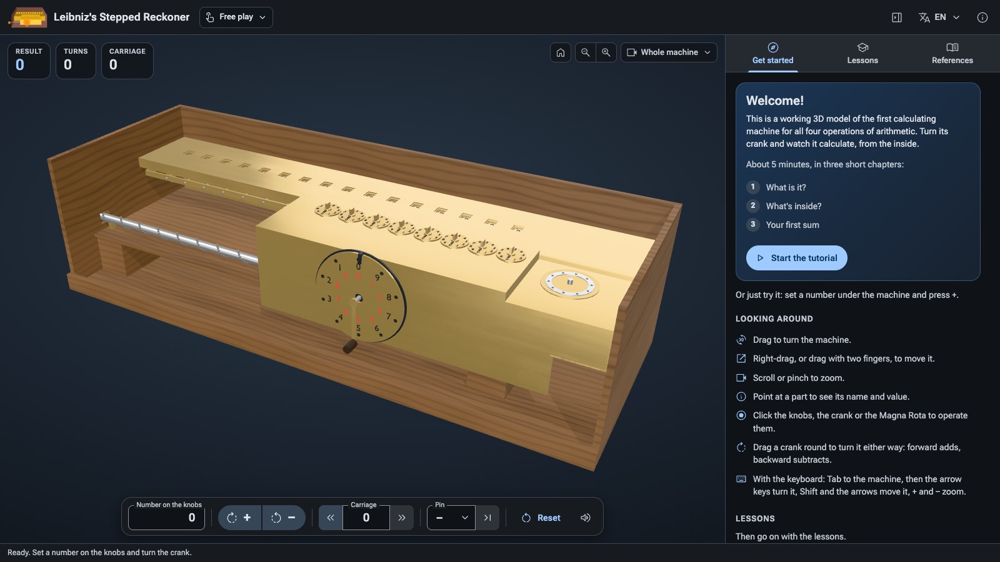
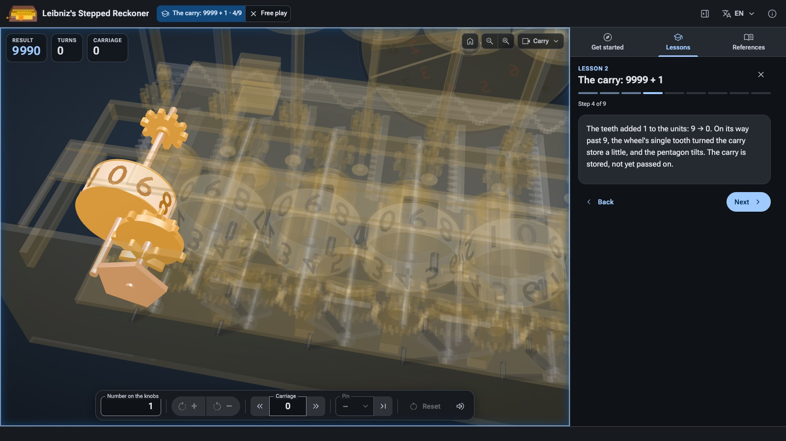
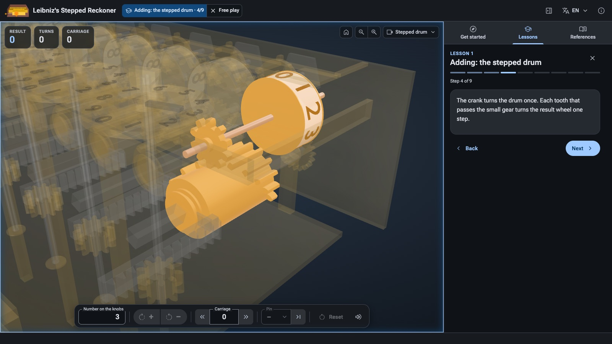

# Leibniz's Stepped Reckoner

[](https://github.com/wixette/leibniz-stepped-reckoner/actions/workflows/test.yml)

**A working 3D model of the first calculating machine for all four operations of arithmetic, in your browser.** Set a number on its knobs, turn the crank, and watch it add, carry, subtract, multiply and divide, from the inside.

**▶ [Open the simulator](https://wixette.github.io/leibniz-stepped-reckoner/)**: nothing to install, free, in ten languages.



## Contents

- [What is the stepped reckoner?](#what-is-the-stepped-reckoner)
- [Your first sum, in one minute](#your-first-sum-in-one-minute)
- [Finding your way around the page](#finding-your-way-around-the-page)
- [The tutorial and the six lessons](#the-tutorial-and-the-six-lessons)
- [How the machine calculates](#how-the-machine-calculates)
- [Things to try](#things-to-try)
- [For teachers](#for-teachers)
- [How faithful is the model?](#how-faithful-is-the-model)
- [Running it on your own computer](#running-it-on-your-own-computer)
- [For developers](#for-developers)
- [Credits](#credits) and [Licence](#licence)

## What is the stepped reckoner?

Gottfried Wilhelm Leibniz (1646–1716), the philosopher and mathematician, wanted a machine that could do long sums so that people would not have to. His stepped reckoner, built in Hannover between about 1690 and his death, was the first calculating machine that could **add, subtract, multiply and divide**. The only one that survives is kept by the Gottfried Wilhelm Leibniz Library in Hannover.

Its key idea is the **stepped drum** (the *Leibniz wheel*): a cylinder with nine teeth of different lengths. Calculating machines were built around it for almost 300 years, until electronic calculators took over in the 1970s.

This simulator lets you operate a faithful 3D model of the surviving machine: 8 setting knobs, a 16-digit result register, a sliding carriage and the big *Magna Rota* wheel with its crank. Every part that takes part in a calculation moves as it does in the real machine, and you can look inside while it works.

## Your first sum, in one minute

1. **[Open the simulator](https://wixette.github.io/leibniz-stepped-reckoner/).** It runs in any current browser (Chrome or Edge 123, Safari 17.2, Firefox 138 or later), on a laptop, a Chromebook, a tablet or a phone.
2. **Set a number.** Type `2` in the *Number on the knobs* box under the machine. The units knob (the one on the right) turns to 2.
3. **Turn the crank forward.** Press **↻ +**. The crank turns once and the result windows on top of the machine show `2`.
4. **Add another number.** Replace the 2 in the box with `3` (so the knobs show 3, not 23) and press **↻ +** again. The windows show `5`: you have just calculated on a machine from about 1700.
5. **Carry on learning.** Press *Start the tutorial* in the panel on the right for a five-minute tour, then work through the lessons.

## Finding your way around the page

| Region | What it is for |
|---|---|
| **Top bar** | The mode you are in (*Free play*, or the lesson and its step, with **✕ Free play** to leave it), the panel button, the language menu (文A) and *About*. |
| **The machine** (3D view) | The machine itself. Readouts at the top left show the **Result** (as the windows show it), the **Turns** counted by the Magna Rota (red when turned backward) and the **Carriage**'s place. The view controls are at the top right. |
| **The toolbar** (under the machine) | Everything that operates the machine (below). |
| **The panel** (right, or below on a narrow screen) | Three tabs: **Get started** (the tutorial), **Lessons** and **References**. Drag its edge to resize it; it can be hidden from the top bar. |
| **The status line** (bottom) | What just happened, and why a control cannot be used right now. |

### The toolbar

| Control | What it does |
|---|---|
| **Number on the knobs** | Type a number of up to 8 digits; the knobs follow as you type. |
| **↻ +** and **↺ −** | Turn the crank once forward (adds the number on the knobs to the result) or backward (subtracts it). |
| **«  Carriage  »** | Slide the carriage one place left or right. Each place to the left makes a turn count ten times as much. |
| **Pin** and **→\|** | Put the Magna Rota's pin in a hole 1–9, or take it out. *Run to stop* (→\|) then turns the crank forward until the pin reaches the stop: hole 5 means five turns. |
| **Reset** | Clear the machine: all wheels and knobs to 0, the carriage home, the pin out. |
| **🔊** | Turn the machine's sounds on or off. |

### Looking around in 3D

| To… | Mouse or trackpad | Touch screen | Keyboard (Tab to the 3D view first) |
|---|---|---|---|
| Turn the view | drag | drag with one finger | arrow keys |
| Move the view | right-drag | drag with two fingers | Shift + arrow keys |
| Zoom | scroll, or the 🔍 buttons | pinch, or the 🔍 buttons | `+` and `−` |
| Go back to the start | ⌂ (*Reset view*) | ⌂ | Home |

**Point at any part** to see its name and its current value (the digit on a wheel, whether a carry store holds a carry, and so on). **You can also operate the machine by clicking its parts:** click a knob to step its digit (or a digit on its dial to set it), click the crank to turn it forward and Shift-click to turn it back, drag either crank round its axle to turn it either way, click a hole of the Magna Rota to put the pin in, or click a result wheel to move the carriage under it.

The **Views** menu (top right) flies the camera to a close-up: *Whole machine*, *Taken apart*, *Result*, *Setting knobs*, *Magna Rota*, and two **inside views**, *Stepped drum* and *Carry*, which hide the case, open the carriage and fade the parts around the ones they show, while the machine keeps working. *Show case* puts the oak case back on or takes it off. While the machine is taken apart it cannot calculate; choose another view to put it back together.

## The tutorial and the six lessons

The **Get started** tab holds a five-minute tutorial in three chapters: *What is it?* (the machine's story), *What's inside?* (a tour of its parts) and *Your first sum* (2 + 3, done by you).

The **Lessons** tab then goes from adding to dividing. Each lesson builds on the one before, and each one is a series of short steps: some show you something on the machine, and some are your turn to operate it (the control to use glows amber, and *Next* unlocks when you have done it).

| # | Lesson | What you learn |
|---|---|---|
| 1 | **Adding: the stepped drum** | How one turn of the crank adds the number on the knobs, one digit and then a whole number at once. |
| 2 | **The carry: 9999 + 1** | What happens when a wheel passes from 9 to 0: the carry is stored first, then passed on, and can run along every digit. |
| 3 | **Subtracting: turn the other way** | Turning the crank backward subtracts; a borrow is a carry in reverse; what the machine shows below zero. |
| 4 | **The carriage: places and × 10** | Sliding the carriage one place makes the same number count ten times as much. |
| 5 | **Multiplying: 1709 × 365** | Digit by digit, with the carriage and the Magna Rota's pin: 14 turns instead of 365 additions. |
| 6 | **Dividing: 623785 ÷ 1709** | Subtracting until the result goes below zero, adding back once, and reading each digit of the answer on the Magna Rota. |



You can leave a lesson at any time (✕ *Free play* in the top bar) to try something on your own, and pick it up again later from the *Free play* menu. Finished lessons get a tick, remembered in your browser.

## How the machine calculates

A short guide to the parts you will meet in the lessons, in the order a calculation uses them.



- **Setting knobs.** The 8 knobs on the front part (the *carriage*) hold the number to add or subtract, one digit each, with the units on the right.
- **Stepped drums.** Under each knob is a stepped drum: a cylinder with nine teeth of graded length. Setting a digit slides the drum along, so that exactly that many teeth will meet the small gear of a result wheel as the drum turns. Set 3, and three teeth pass: the result wheel moves three steps.
- **The crank and the Magna Rota.** The crank at the front turns every drum once, all at the same time, so a whole number is added in one turn. Forward adds, backward subtracts. The big wheel around the crank, the *Magna Rota*, counts the turns: black numbers for forward turns, red ones for backward turns.
- **The result register.** The 16 wheels at the back show the result in the windows on top, units on the right. It stays in place while the carriage moves.
- **The carry.** When a wheel passes from 9 to 0, its single tooth turns a **carry store** a little, and the store's **pentagon** tilts: the carry is *stored*, not yet added. At the end of the turn the **carry levers** pass each store in turn, units first, and add the stored carry to the next wheel. If that wheel passes 9 too, it stores its own carry just before its lever arrives, so 9999 + 1 becomes 10000 in a single turn. (A subtraction does the same in reverse: a *borrow*.)
- **The carriage.** The end crank on the left slides the whole carriage along the register, one place at a time. One place to the left puts the knobs' units over the register's tens, so each turn now adds ten times the number. That is how the machine multiplies by a number with several digits.
- **The pin and the stop.** For multiplying, put the pin in the Magna Rota's hole for the multiplier's digit, say 5, and turn: the crank stops at the stop after exactly five turns. Then slide the carriage and do the next digit.
- **Below zero.** The machine has no minus sign. Subtract more than there is and the front wheels turn to 9s: the result has gone below zero. When dividing, that is the sign that you have subtracted once too often, so you add the divisor back once and read the digit of the answer on the Magna Rota.

### A worked example: 1709 × 365

| Step | On the machine | Result |
|---|---|---|
| 1 | Set 1709. Pin in hole 5, *Run to stop*: five turns. | 8 545 |
| 2 | Carriage one place left (each turn now adds 17 090). Pin in hole 6, *Run to stop*. | 111 085 |
| 3 | Carriage one more place left (170 900 a turn). Pin in hole 3, *Run to stop*. | 623 785 |

That is 5 + 6 + 3 = 14 turns of the crank instead of 365 additions. Lesson 5 takes you through it, and lesson 6 divides 623785 by 1709 to get 365 back.

## Things to try

Use **Reset** before each one.

- **Eight carries in one turn.** Set 99999999 (the largest number the knobs hold) and press **↻ +**. Then set 1, choose the *Carry* view, and press **↻ +** again: every pentagon tilts, the carries run along, and the result is 100000000.
- **Times eleven without multiplying.** Set 12 and press **↻ +**. Slide the carriage one place left (**«**) and press **↻ +** again. 12 + 120 = 132 = 12 × 11.
- **Times by the pin.** Set 25, put the pin in hole 4 and press *Run to stop*: 100. Watch the Magna Rota count the turns.
- **Go below zero.** Set 1 and press **↺ −**. What do the windows show, and why?
- **Look inside.** Choose *Taken apart* in the Views menu to see the two main parts separated, then *Stepped drum*: set a digit and turn the crank to watch the drum's teeth turn the result wheel.

## For teachers

- **No installation, no accounts.** The simulator is a static web page that needs no network but its own site (no fonts or scripts from other servers), so it works on school networks that block a lot. It is laid out for a laptop or Chromebook, and every lesson can also be done on a phone.
- **Ten languages:** English, Español, Français, Deutsch, Italiano, Português (Brasil), 简体中文, 繁體中文, 日本語 and 한국어. Choose one from the 文A menu, or link to it directly by adding `?lang=` to the address: `?lang=de`, `?lang=fr`, `?lang=pt-BR`, `?lang=zh-TW`, … ([German](https://wixette.github.io/leibniz-stepped-reckoner/?lang=de), [Japanese](https://wixette.github.io/leibniz-stepped-reckoner/?lang=ja)).
- **Progress stays on the device.** Finished lessons, a lesson left half-way, the language, the panel's size and the sound setting are remembered in the browser, and nothing is sent anywhere.
- **The texts can be copied** into a worksheet: the lesson steps, the tutorial and the result can be selected like any text.
- **Accessible:** every control can be reached with the keyboard and has a translated name for screen readers; animations follow the system's *reduce motion* setting.
- **Slow computer?** The page lowers its rendering quality by itself if the 3D view is slow. To start in the lighter mode straight away, add `?quality=lite` to the address.
- **Where to read more:** the *References* tab lists museums with replicas, the library that keeps the original, and articles on the machine and on teaching with it.

## How faithful is the model?

The model is **kinematically faithful**: the mechanism and its angles follow the published sources (the timing of the drum's teeth, the stored carry and its pentagon, the staggered carry levers, the 37 mm step of the carriage), and the dimensions come from the published measurements and from photographs of the original and of the replica at TU Dresden. Many small part sizes had to be estimated, and the digits are deliberately larger than on the original so that they can be read on a screen.

Where the sources disagree or say nothing, the choice is written down with its reason. The best-known example is the carry: historians read the original in two ways, and lesson 2 shows both ([decision 0001](design/decisions/0001-carry-interpretation.md)). Every dimension and angle, with its source and how sure we are of it, is in [params/machine.json](params/machine.json), and the research behind it is in [research/REPORT.md](research/REPORT.md).

## Running it on your own computer

There is nothing to build: the simulator is plain HTML, CSS and JavaScript. You need [Git LFS](https://git-lfs.com) for the 3D models, and any static web server, for example Python's:

```
git lfs install
git clone https://github.com/wixette/leibniz-stepped-reckoner.git
cd leibniz-stepped-reckoner
python3 -m http.server 8000
```

Then open <http://localhost:8000/>. (Opening `index.html` straight from disk does not work, because browsers do not load JavaScript modules from `file://`.) To put it on your own web server, copy the whole folder there, with the LFS files checked out.

## For developers

The code is plain JavaScript modules with JSDoc types, three.js is vendored, and the 3D model is built from [params/machine.json](params/machine.json) by headless Blender scripts. The developer pages at <http://localhost:8000/dev/> show each stage of the model on its own (one digit, the carry, the full machine), each with an acceptance self-test (`?selftest`).

```
pnpm install
pnpm check:refs   # no private references, local paths or broken links
pnpm typecheck    # the JSDoc types, checked strictly; nothing is compiled
pnpm test         # simulator logic, kinematics and acceptance tests on the 3D model
```

Start with **[docs/development.md](docs/development.md)**: requirements, checks, the folder layout, versions and releases, deploying behind a cache, and a map of the design documents. The rules the code follows are in [docs/conventions.md](docs/conventions.md), and the page's design principles in [docs/ui-design.md](docs/ui-design.md).

## Credits

The research and the model rely in particular on:
- A. Burkhardt and W. Jordan, *Zeitschrift für Vermessungswesen* 26 (1897)
- M. Ludwig (TU Dresden, 2006), on N. J. Lehmann's reconstructions
- E. Stein and F. O. Kopp (Leibniz Universität Hannover)
- K. Badur and W. Rottstedt
- the Arithmeum Bonn
- the Gottfried Wilhelm Leibniz Bibliothek

Reference photographs of the TU Dresden replica come from Wikimedia Commons contributors Dr. Bernd Gross, Plenuska, Eremeev, Wuselig, Jeremy Wolf and SchiDD (CC BY-SA 4.0). The tutorial's pictures are by Hajotthu (CC BY 3.0), Barbarah and Eremeev (CC BY-SA 4.0), and from Jacob Leupold's *Theatrum Arithmetico-Geometricum* of 1727 (public domain). The full list is in [research/images/ATTRIBUTION.md](research/images/ATTRIBUTION.md) and [research/sources/bibliography.md](research/sources/bibliography.md).

The machine's sounds are adapted from sound effects on [Pixabay](https://pixabay.com), under the [Pixabay Content License](https://pixabay.com/service/license-summary/).

Built with [three.js](https://threejs.org) and [three-mesh-bvh](https://github.com/gkjohnson/three-mesh-bvh), the [Roboto Flex](https://fonts.google.com/specimen/Roboto+Flex) font and [Material Symbols](https://fonts.google.com/icons) icons.

## Licence

- **Code:** [Apache-2.0](LICENSE)
- **Original content** (3D models, textures, research notes, lessons, docs, the screenshots in this README): [CC BY-SA 4.0](LICENSES/CC-BY-SA-4.0.txt)
- **Third-party material** keeps its own licence, declared per path in [REUSE.toml](REUSE.toml) and summarised in [docs/licensing.md](docs/licensing.md)
