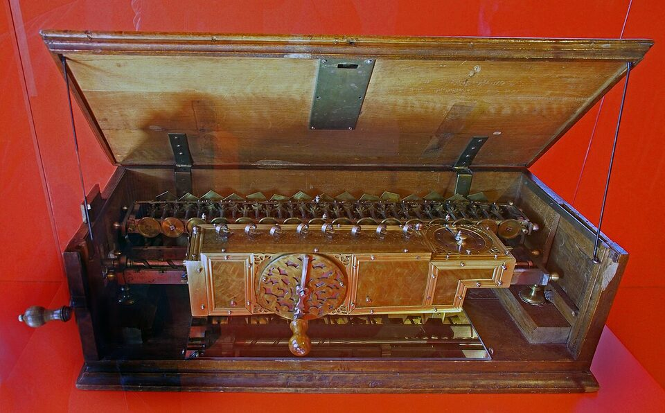
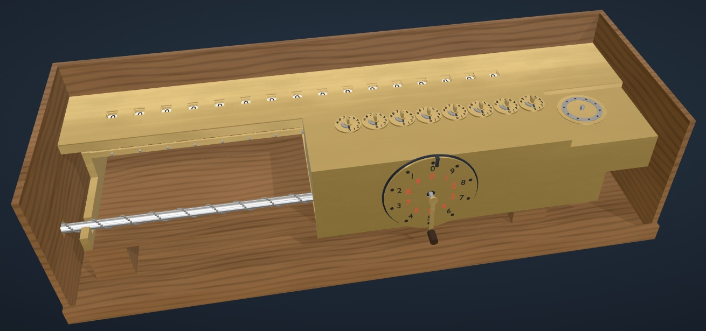
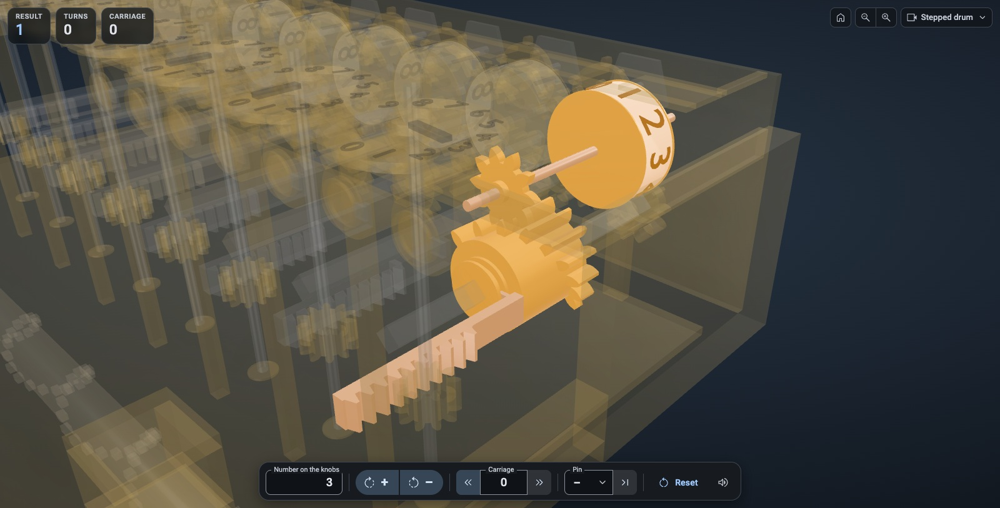
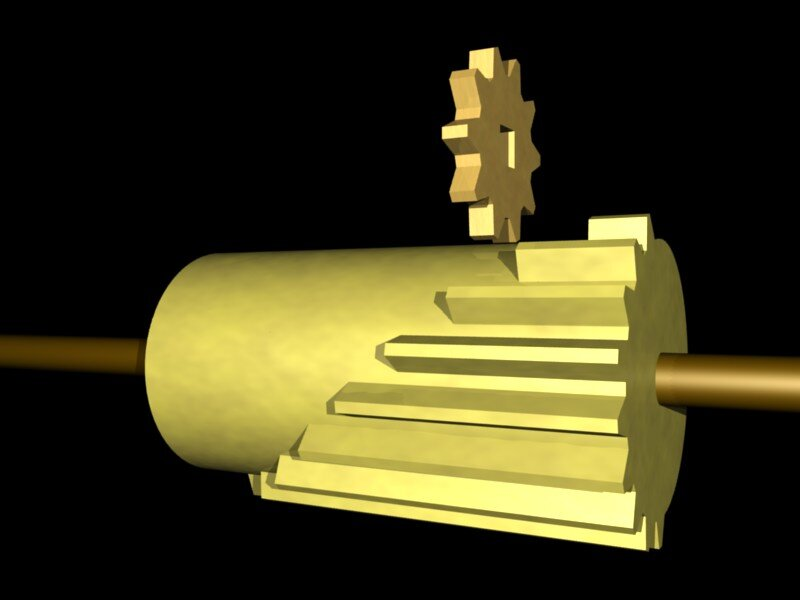
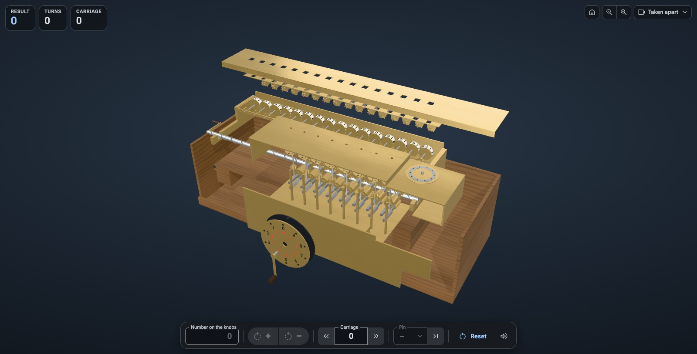
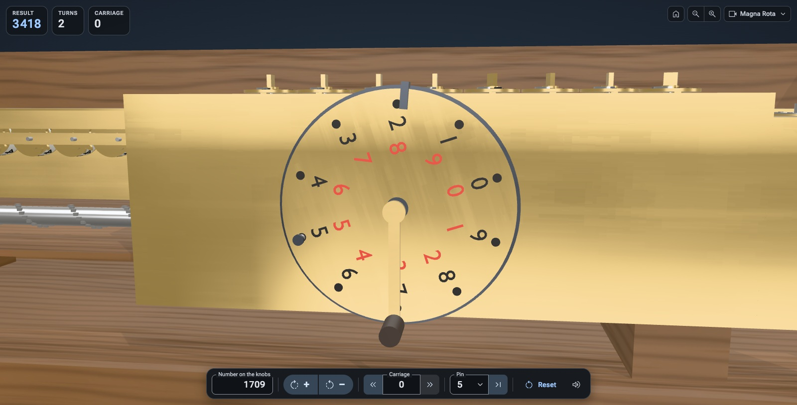

# Leibniz's Stepped Reckoner

[](https://github.com/wixette/leibniz-stepped-reckoner/actions/workflows/test.yml)

**A working 3D model of the first calculating machine for all four operations of arithmetic, in your browser.** Set a number on its knobs, turn the crank, and watch it add, carry, subtract, multiply and divide, from the inside.

**[Open the simulator](https://wixette.github.io/leibniz-stepped-reckoner/)**: nothing to install, free, in ten languages.


## The machine

Gottfried Wilhelm Leibniz (1646–1716), the philosopher and mathematician, wanted a machine that could do long sums so that people would not have to. His **stepped reckoner**, built in Hannover between about 1690 and his death, was the first calculating machine that could **add, subtract, multiply and divide**. One survives, in the Gottfried Wilhelm Leibniz Library in Hannover. Its key idea, the **stepped drum**, was at the heart of calculating machines for almost 300 years, until electronic calculators took over in the 1970s.

The original is behind glass. This one you can turn: 8 setting knobs, a 16-digit result register, a sliding carriage and the big *Magna Rota* with its crank, each part moving as it does in the real machine.

| The original in Hannover | The simulator |
|---|---|
|  |  |
| Photo: [Hajotthu](https://commons.wikimedia.org/wiki/File:Leibniz_Rechenmaschine_%281690%29.jpg), CC BY 3.0 | [Open it](https://wixette.github.io/leibniz-stepped-reckoner/) and turn the crank |

## Your first sum

[Open the simulator](https://wixette.github.io/leibniz-stepped-reckoner/). Everything that works the machine is in the toolbar under it.

1. **Set a number.** Type `2` in *Number on the knobs*, at the left of the toolbar. The units knob, the one on the right of the carriage, turns to 2.
2. **Turn the crank.** Press **+**. The crank turns once, every drum turns with it, and the windows on top of the machine show `2` (so does *Result*, at the top left).
3. **Add another number.** Type `3` in place of the 2 and press **+** again: `5`. You have just calculated on a machine from about 1700. **−** turns the crank backward and subtracts.
4. **Look inside.** Open the **Views** menu at the top right, choose *Stepped drum* and press **+** once more. The case disappears, the other parts fade, and you can watch the drum's teeth turn the result wheel.

   

5. **Look around.** Drag to turn the machine, scroll or pinch to zoom, and point at any part to see its name and value. The parts work too: click a knob to step its digit, or drag the crank round.

When you want more, the panel on the right holds a five-minute **tutorial** (*Get started*), the **lessons** and the **references**.

<details>
<summary><b>All the controls</b></summary>

| In the toolbar | What it does |
|---|---|
| **Number on the knobs** | Type a number of up to 8 digits; the knobs follow as you type. |
| **+** and **−** | Turn the crank once forward (adds the number on the knobs to the result) or backward (subtracts it). |
| **Carriage** ‹ › | Slide the carriage one place left or right; the box shows its place. Each place to the left makes a turn count ten times as much. |
| **Pin** and **Run to stop** | Put the Magna Rota's pin in a hole 1–9, or take it out; *Run to stop* turns the crank until the pin reaches the stop (hole 5: five turns). |
| **Reset** | All wheels and knobs to 0, the carriage home, the pin out. |
| **Sound** | The machine's sounds on or off. |

| To… | Mouse or trackpad | Touch screen | Keyboard (Tab to the 3D view first) |
|---|---|---|---|
| Turn the view | drag | drag with one finger | arrow keys |
| Move the view | right-drag | drag with two fingers | Shift + arrow keys |
| Zoom | scroll, or the magnifiers at the top right | pinch | `+` and `−` |
| Go back to the start | the house at the top right | the house | Home |

**Clicking the machine:** click a knob to step its digit, or a digit on its dial to set it; click the crank to turn it forward, Shift-click to turn it back, or drag either crank round its axle; click a hole of the Magna Rota to put the pin in; click a result wheel to move the carriage under it.

**The Views menu:** *Whole machine*, *Taken apart*, *Result*, *Setting knobs*, *Magna Rota*, and the two inside views, *Stepped drum* and *Carry*, which hide the case and fade the parts around the ones they show while the machine keeps working. *Show case* puts the oak case on or off. Taken apart, the machine cannot calculate; choose another view to put it back together.

**Around the machine:** readouts at the top left (*Result*, the *Turns* the Magna Rota has counted, red when backward, and the *Carriage*'s place); the top bar with the mode (*Free play*, or the lesson and its step), the panel button, the language menu and *About*; and a status line at the bottom that says what just happened, or why a control cannot be used right now.

</details>

## How it calculates, in six lessons

The **Lessons** tab teaches the machine in six short lessons, from adding to dividing. Each is a few steps in the panel: some show you something, and some are your turn (the control to use glows amber, and *Next* unlocks when you have done it). You can leave a lesson for free play at any time and pick it up later; finished lessons get a tick.

### 1. Adding: the stepped drum

Under each knob is a **stepped drum**, a cylinder with nine teeth of graded length. Setting a digit slides the drum along so that exactly that many teeth meet the small gear of a result wheel: set 3, and as the drum turns three teeth pass and the wheel moves three steps. The crank turns all 8 drums at once, so a whole number is added in one turn.



*The principle of the stepped drum. Picture: [Barbarah](https://commons.wikimedia.org/wiki/File:Staffelwalzeprinzipbha.jpg), CC BY-SA 4.0*

### 2. The carry: 9999 + 1

When a wheel passes from 9 to 0, its single tooth turns a **carry store**, and the store's **pentagon** tilts: the carry is stored, not yet added. At the end of the turn the **carry levers** sweep past the stores, units first, and pass each stored carry on to the next wheel. If that wheel passes 9 too, it stores its own carry just before its lever arrives, so 9999 + 1 becomes 10000 in a single turn.


### 3. Subtracting: turn the other way

Turning the crank backward subtracts, and a borrow is a carry in reverse. The machine has no minus sign: subtract more than there is, and the front wheels turn to 9s.

### 4. The carriage: places and × 10

The register at the back stays in place; the carriage at the front, with the knobs and drums, slides along it. One place to the left puts the knobs' units over the register's tens, so each turn adds ten times the number.



### 5. Multiplying: 1709 × 365

Multiplying is adding again and again, one digit of the multiplier at a time. Put the pin in the Magna Rota's hole for the digit, and the crank stops after exactly that many turns; then slide the carriage one place and do the next digit.

| Step | On the machine | Result |
|---|---|---|
| 1 | Set 1709. Pin in hole 5, *Run to stop*: five turns. | 8 545 |
| 2 | Carriage one place left (each turn now adds 17 090). Pin in hole 6, *Run to stop*. | 111 085 |
| 3 | One more place left (170 900 a turn). Pin in hole 3, *Run to stop*. | 623 785 |

Fourteen turns instead of 365 additions.



### 6. Dividing: 623785 ÷ 1709

Dividing is subtracting again and again. Subtract until the result goes below zero (its front wheels turn to 9s), add the divisor back once, and read that digit of the answer on the Magna Rota's red numbers; then slide the carriage one place right for the next digit.

## Things to try

Use **Reset** before each one.

- **Eight carries in one turn.** Set 99999999 (the largest number the knobs hold) and press **+**. Then set 1, choose the *Carry* view, and press **+** again: every pentagon tilts, the carries run along, and the result is 100000000.
- **Times eleven without multiplying.** Set 12 and press **+**. Slide the carriage one place left (the carriage's left arrow) and press **+** again. 12 + 120 = 132 = 12 × 11.
- **Times by the pin.** Set 25, put the pin in hole 4 and press *Run to stop*: 100. Watch the Magna Rota count the turns.
- **Go below zero.** Set 1 and press **−**. What do the windows show, and why?

## For teachers

- **No installation, no accounts.** The simulator is a static web page that needs no network but its own site (no fonts or scripts from other servers), so it works on school networks that block a lot. It is laid out for a laptop or Chromebook, and every lesson can also be done on a phone. It runs in Chrome or Edge 123, Safari 17.2, Firefox 138 or later.
- **Ten languages:** English, Español, Français, Deutsch, Italiano, Português (Brasil), 简体中文, 繁體中文, 日本語 and 한국어. Choose one from the language menu in the top bar, or link to it directly by adding `?lang=` to the address: `?lang=de`, `?lang=fr`, `?lang=pt-BR`, `?lang=zh-TW`, … ([German](https://wixette.github.io/leibniz-stepped-reckoner/?lang=de), [Japanese](https://wixette.github.io/leibniz-stepped-reckoner/?lang=ja)).
- **Progress stays on the device.** Finished lessons, a lesson left half-way, the language, the panel's size and the sound setting are remembered in the browser, and nothing is sent anywhere.
- **The texts can be copied** into a worksheet: the lesson steps, the tutorial and the result can be selected like any text.
- **Accessible:** every control can be reached with the keyboard and has a translated name for screen readers; animations follow the system's *reduce motion* setting.
- **Slow computer?** The page lowers its rendering quality by itself if the 3D view is slow. To start in the lighter mode straight away, add `?quality=lite` to the address.
- **Where to read more:** the *References* tab lists museums with replicas, the library that keeps the original, and articles on the machine and on teaching with it.

## How faithful is the model?

The model is **kinematically faithful**: the mechanism and its angles follow the published sources (the timing of the drum's teeth, the stored carry and its pentagon, the staggered carry levers, the 36.5 mm step of the carriage). Where they exist, the dimensions follow N. J. Lehmann's workshop drawings of the replica at TU Dresden, kept in the Deutsches Museum's archive; the rest come from the published measurements and from photographs of the original and of that replica. Many small part sizes had to be estimated, and the digits are deliberately larger than on the original so that they can be read on a screen.

Where the sources disagree or say nothing, the choice is written down with its reason. The best-known example is the carry: historians read the original in two ways, and lesson 2 shows both ([decision 0001](design/decisions/0001-carry-interpretation.md)). Every dimension and angle, with its source and how sure we are of it, is in [params/machine.json](params/machine.json), and the research behind it is in [research/REPORT.md](research/REPORT.md).

## Running it on your own computer

There is nothing to build: the simulator is plain HTML, CSS and JavaScript. You need [Git LFS](https://git-lfs.com) for the 3D models, and any static web server, for example Python's:

```
git lfs install
git clone https://github.com/wixette/leibniz-stepped-reckoner.git
cd leibniz-stepped-reckoner
python3 -m http.server 8000
```

Then open <http://localhost:8000/>. (Opening `index.html` straight from disk does not work, because browsers do not load JavaScript modules from `file://`.) To put it on your own web server, copy the whole folder there, with the LFS files checked out.

## For developers

The code is plain JavaScript modules with JSDoc types, three.js is vendored, and the 3D model is built from [params/machine.json](params/machine.json) by headless Blender scripts. The developer pages at <http://localhost:8000/dev/> show each stage of the model on its own (one digit, the carry, the full machine), each with an acceptance self-test (`?selftest`).

```
pnpm install
pnpm check:refs   # no private references, local paths or broken links
pnpm typecheck    # the JSDoc types, checked strictly; nothing is compiled
pnpm test         # simulator logic, kinematics and acceptance tests on the 3D model
```

Start with **[docs/development.md](docs/development.md)**: requirements, checks, the folder layout, versions and releases, deploying behind a cache, and a map of the design documents. The rules the code follows are in [docs/conventions.md](docs/conventions.md), and the page's design principles in [docs/ui-design.md](docs/ui-design.md).

## Credits

The research and the model rely in particular on:
- A. Burkhardt and W. Jordan, *Zeitschrift für Vermessungswesen* 26 (1897)
- M. Ludwig (TU Dresden, 2006), on N. J. Lehmann's reconstructions
- N. J. Lehmann's construction drawings of the TU Dresden replica: Deutsches Museum München, NL 183/465 and NL 183/466 PLAN (dimensions only; the drawings themselves are not reproduced)
- E. Stein and F. O. Kopp (Leibniz Universität Hannover)
- K. Badur and W. Rottstedt
- the Arithmeum Bonn
- the Gottfried Wilhelm Leibniz Bibliothek

Reference photographs of the TU Dresden replica come from Wikimedia Commons contributors Dr. Bernd Gross, Plenuska, Eremeev, Wuselig, Jeremy Wolf and SchiDD (CC BY-SA 4.0). The pictures of the original and of the stepped drum in this README and the tutorial are by Hajotthu (CC BY 3.0) and Barbarah (CC BY-SA 4.0); the tutorial's others are by Eremeev (CC BY-SA 4.0) and from Jacob Leupold's *Theatrum Arithmetico-Geometricum* of 1727 (public domain). The full list is in [research/images/ATTRIBUTION.md](research/images/ATTRIBUTION.md) and [research/sources/bibliography.md](research/sources/bibliography.md).

The machine's sounds are adapted from sound effects on [Pixabay](https://pixabay.com), under the [Pixabay Content License](https://pixabay.com/service/license-summary/).

Built with [three.js](https://threejs.org) and [three-mesh-bvh](https://github.com/gkjohnson/three-mesh-bvh), the [Roboto Flex](https://fonts.google.com/specimen/Roboto+Flex) font and [Material Symbols](https://fonts.google.com/icons) icons.

## Licence

- **Code:** [Apache-2.0](LICENSE)
- **Original content** (3D models, textures, research notes, lessons, docs, the screenshots in this README): [CC BY-SA 4.0](LICENSES/CC-BY-SA-4.0.txt); the two pictures credited above keep their own licences
- **Third-party material** keeps its own licence, declared per path in [REUSE.toml](REUSE.toml) and summarised in [docs/licensing.md](docs/licensing.md)
